# BCS351 Java Programming Lab — Execution Outputs
**Student:** Krishna Yadav  |  **Student ID:** BCS2025400

## Assignment 1: Hello World, Variables and Arithmetic

### Question 1
```text
Hello World
Welcome to Java
```
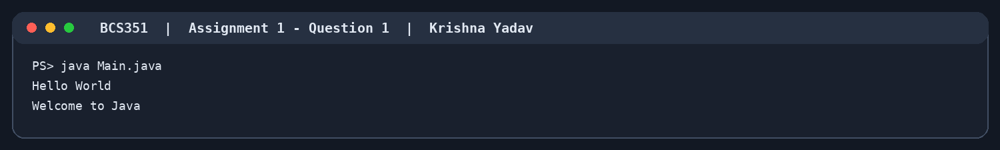

### Question 2
```text
Roll: 101
Percentage: 84.5
Section: B
Name: Asha
```
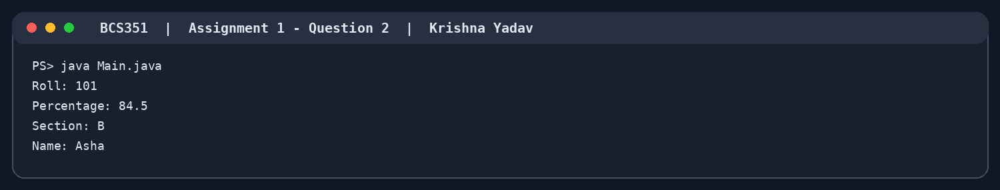

### Question 3
```text
Sum: 22
Difference: 12
Product: 85
Quotient: 3
Remainder: 2
```
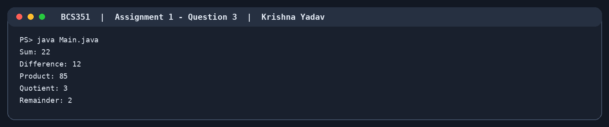

### Question 4
```text
Area: 153.86
Perimeter: 43.96
```
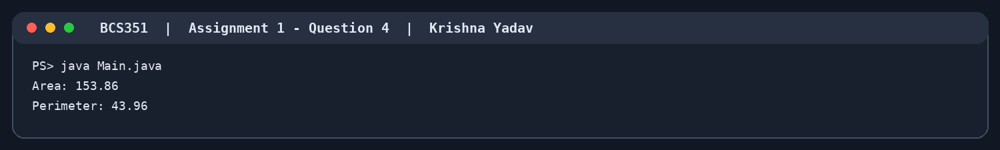

## Assignment 2: Decisions and Loops with Numbers

### Question 1
```text
27 is odd
```


### Question 2
```text
Grade: B
```
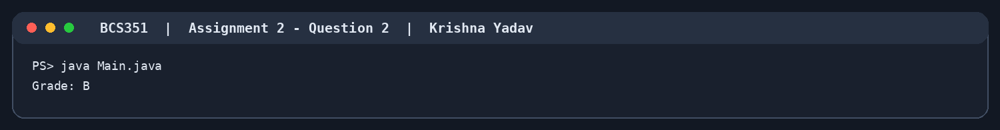

### Question 3
```text
Leap year
```


### Question 4
```text
Factorial of 5 is 120
```
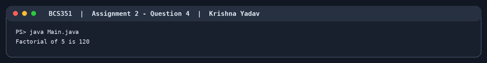

## Assignment 3: Star and Number Patterns

### Question 1
```text
****
****
****
****
```
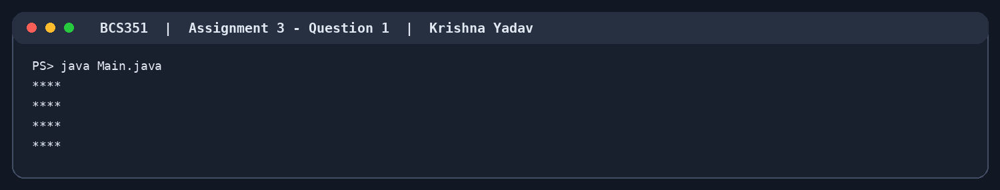

### Question 2
```text
*
**
***
****
```
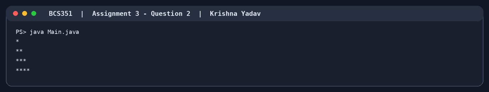

### Question 3
```text
1 
1 2 
1 2 3 
1 2 3 4
```
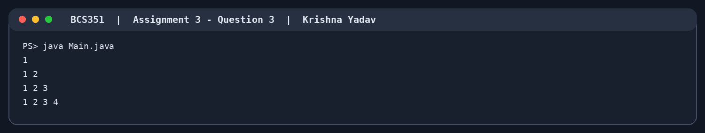

### Question 4
```text
****
***
**
*
```
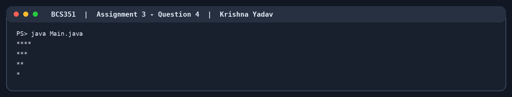

## Assignment 4: Writing Functions

### Question 1
```text
5C2 = 10
```
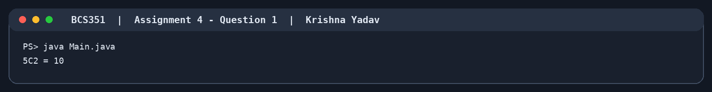

### Question 2
```text
5P2 = 20
```
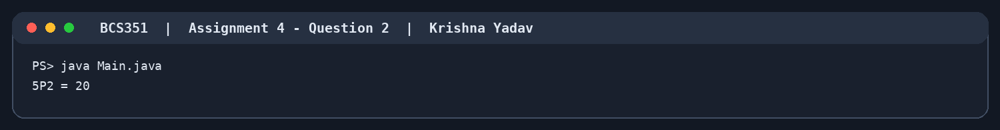

### Question 3
```text
Larger: 14
```


## Assignment 5: Arrays: Traversal and Counting

### Question 1
```text
Index 0: 3
Index 1: 4
Index 2: 5
```
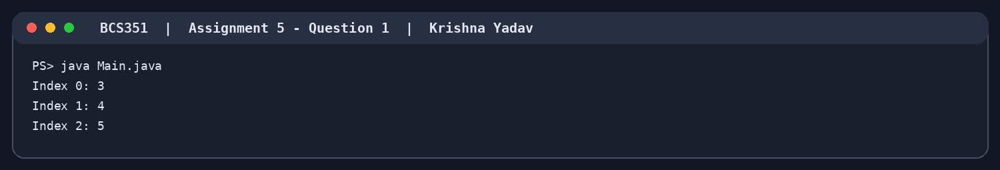

### Question 2
```text
Sum: 118
Largest: 45
```
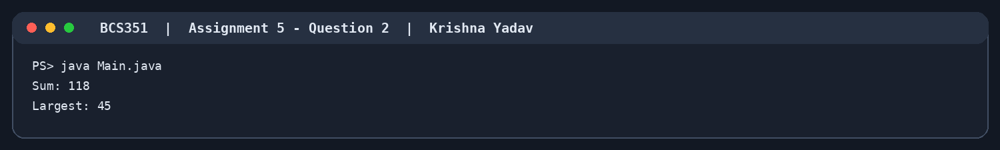

### Question 3
```text
Count greater than 10: 2
```


## Assignment 6: Arrays: Reverse and Duplicates

### Question 1
```text
50
40
30
20
10
```
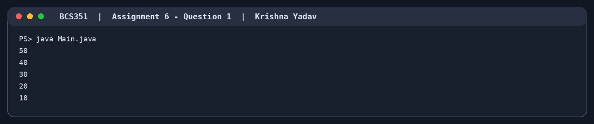

### Question 2
```text
Smallest: 1 at index 2
```
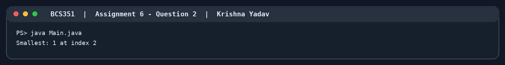

### Question 3
```text
Repeated value: 9
```
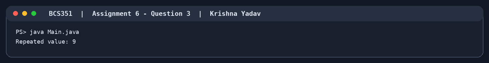

## Assignment 7: Counting Steps and Complexity

### Question 1
```text
Steps: 10
```


### Question 2
```text
Steps: 100
```
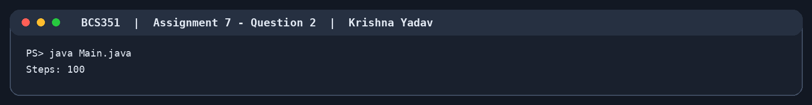

### Question 3
```text
Halving steps: 10
```
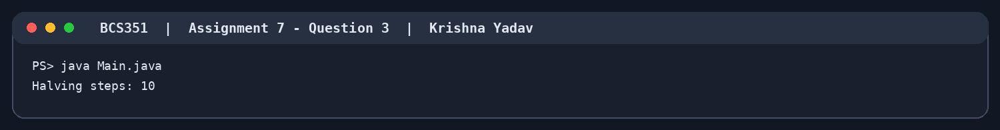

## Assignment 8: Matrices: Transpose and Row Sums

### Question 1
```text
1 2 3 4 
5 6 7 8 
9 10 11 12
```
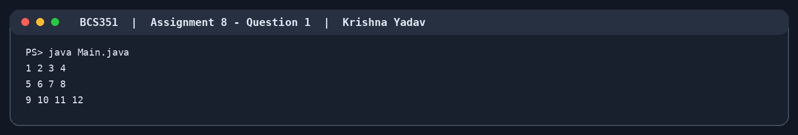

### Question 2
```text
1 4 7 
2 5 8 
3 6 9
```
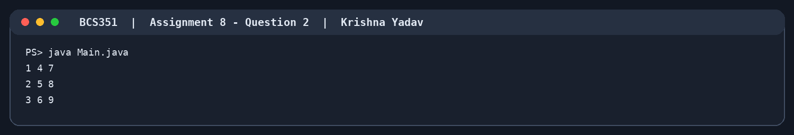

### Question 3
```text
Row 1 sum: 6
Row 2 sum: 15
Row 3 sum: 24
```


## Assignment 9: Matrices: Rows and Columns

### Question 1
```text
First row: 1 2 3
Last row: 7 8 9
```
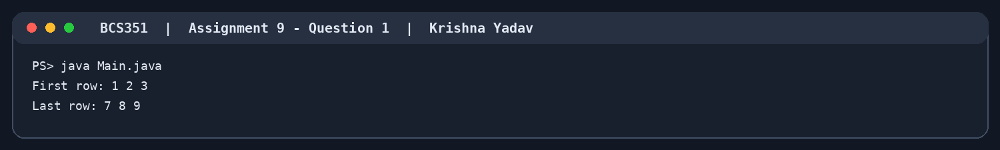

### Question 2
```text
Column 1 sum: 12
Column 2 sum: 15
Column 3 sum: 18
```
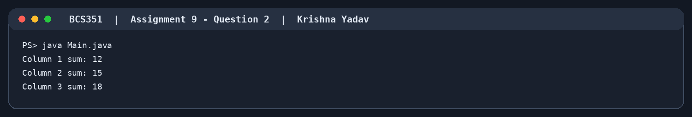

### Question 3
```text
Values greater than 5: 4
```
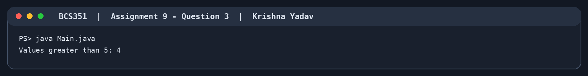

## Assignment 10: Switch and ArrayList

### Question 1
```text
Wednesday
```


### Question 2
```text
[10, 20, 30, 40]
Size: 4
Item at index 2: 30
```
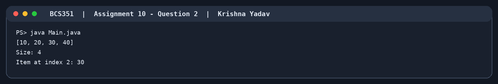

### Question 3
```text
[10, 25, 30]
Size: 3
```
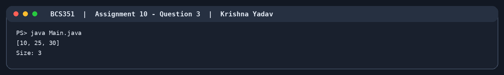

## Assignment 11: Bubble Sort and Selection Sort

### Question 1
```text
Sorted: [1, 2, 4, 5, 8]
```
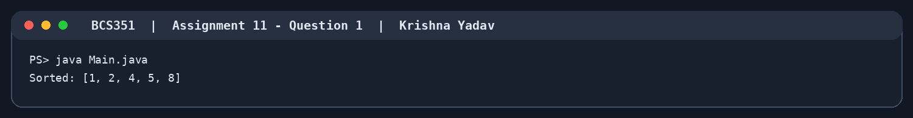

### Question 2
```text
Sorted: [11, 12, 22, 25, 64]
```
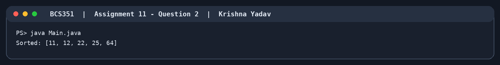

### Question 3
```text
Swaps: 4
```


## Assignment 12: Insertion Sort

### Question 1
```text
Sorted: [1, 3, 5, 7]
```
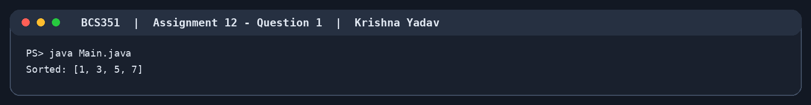

### Question 2
```text
Sorted: [3, 6, 9, 14, 21]
```
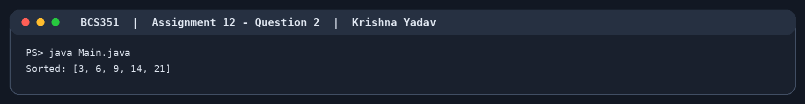

### Question 3
```text
Shifts: 15
```
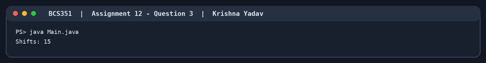

## Assignment 13: Strings: Methods and Palindromes

### Question 1
```text
Length: 11
Position of g: 3
Upper case: PROGRAMMING
```
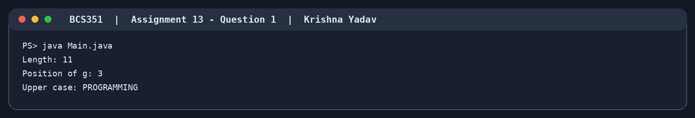

### Question 2
```text
Reversed: avaJ
```
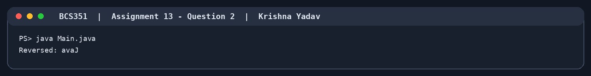

### Question 3
```text
racecar is a palindrome
```
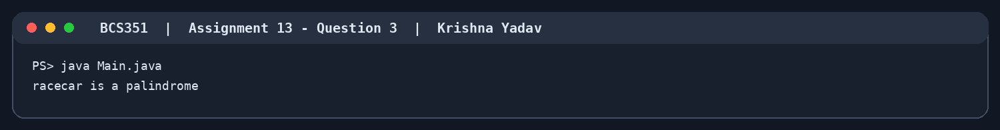

### Question 4
```text
a
ab
abc
b
bc
c
```
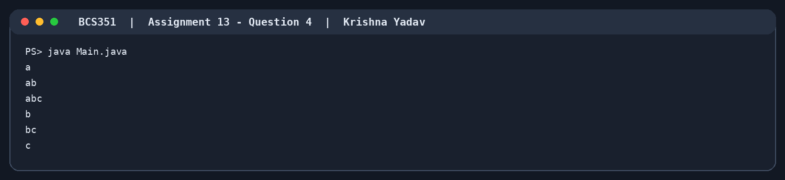

## Assignment 14: Characters: Counting and Positions

### Question 1
```text
Vowels: 3
```


### Question 2
```text
Count of g: 2
```
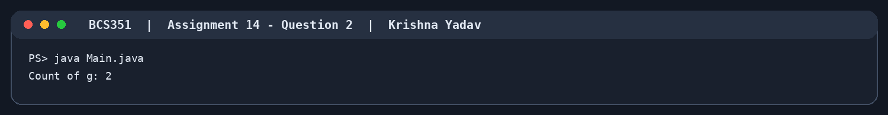

### Question 3
```text
0: h
1: e
2: l
3: l
4: o
```
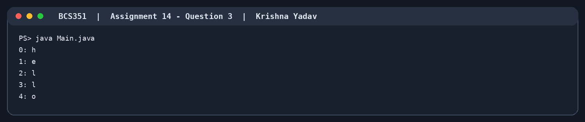

## Assignment 15: StringBuilder Methods

### Question 1
```text
Hello World
Length: 11
```
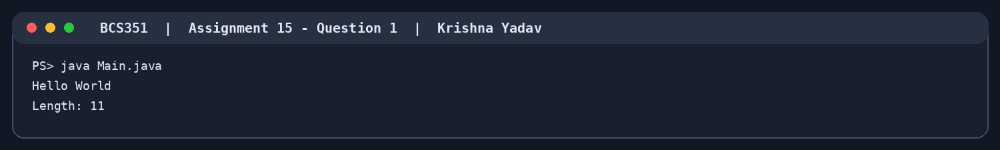

### Question 2
```text
1,2,3,4,5
```
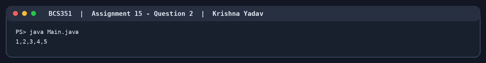

### Question 3
```text
Hello Java
```

